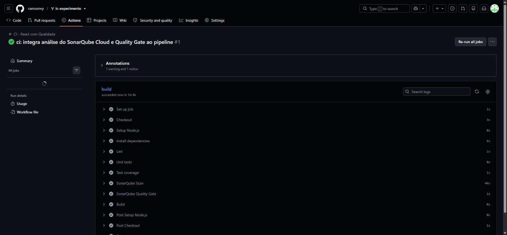
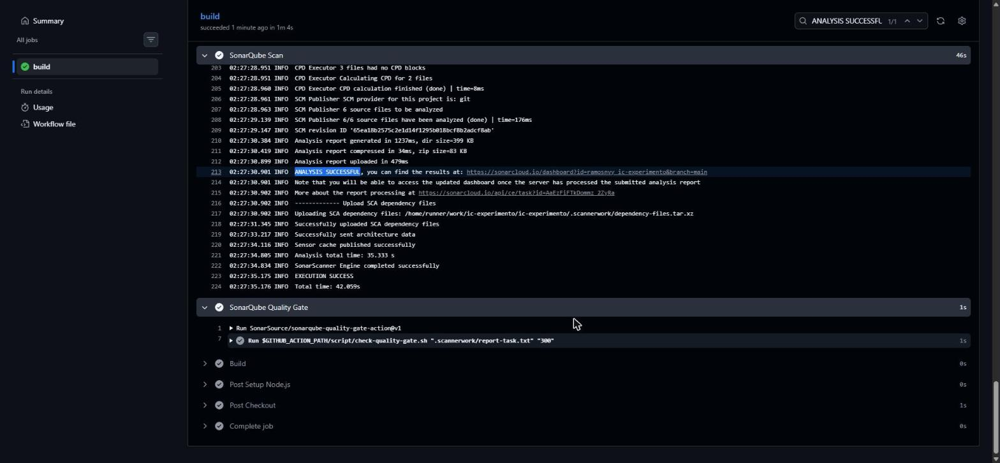
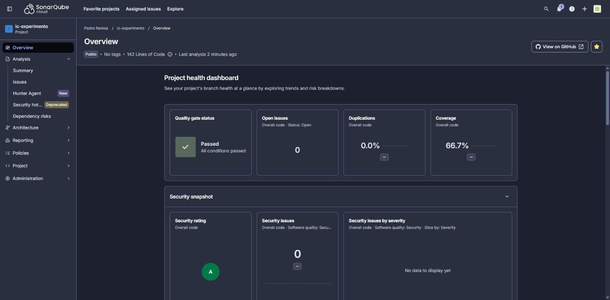
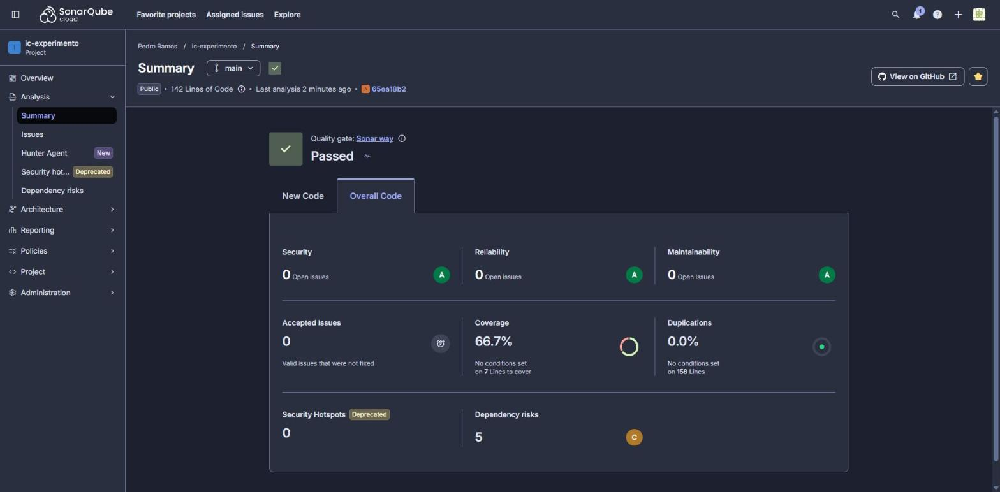

# Catálogo de Tecnologias — Qualidade no Pipeline

Projeto React/Vite usado na aula de **Qualidade de Software no Pipeline**. A aplicação possui uma lista com 30 tecnologias e uma busca por nome, categoria ou descrição.

## O que foi adicionado nesta versão

- ESLint com regras de qualidade (`no-unused-vars`, `no-console` e `eqeqeq`).
- Teste unitário com Vitest para a função de busca.
- Cobertura com `@vitest/coverage-v8`, gerando `coverage/lcov.info`.
- Integração com SonarQube Cloud por `SonarSource/sonarqube-scan-action@v8`.
- Verificação do Quality Gate por `SonarSource/sonarqube-quality-gate-action@v1`.
- Pipeline: Checkout → Setup → Install → Lint → Test → Coverage → SonarQube → Quality Gate → Build.

## Executar localmente

```bash
npm install
npm run dev
```

## Verificações de qualidade

```bash
npm run lint
npm test
npm run coverage
npm run build
```

## Teste unitário

A lógica da busca foi isolada em `src/search.js`. O arquivo `src/search.test.js` verifica, inicialmente, dois comportamentos:

1. busca por um termo (`react`);
2. busca vazia retorna a lista completa.

Isso permite que os alunos adicionem novos casos durante a aula, por exemplo: busca por categoria, descrição, termo inexistente e diferenças entre maiúsculas/minúsculas.

## ESLint

As regras ficam em `eslint.config.js`.

Exemplo:

```js
rules: {
  'no-unused-vars': 'error',
  'no-console': 'error',
  eqeqeq: 'error',
}
```

Para provocar uma falha no pipeline, adicione temporariamente um `console.log()` ao código ou declare uma variável sem utilizá-la.

## SonarQube

O arquivo `sonar-project.properties` define o projeto e informa ao SonarQube onde encontrar o relatório LCOV:

```properties
sonar.javascript.lcov.reportPaths=coverage/lcov.info
```

### Integração com o SonarQube Cloud

Este fork é analisado pelo [SonarQube Cloud](https://sonarcloud.io/project/overview?id=ramosnvy_ic-experimento):

| Informação       | Valor                     |
| ---------------- | ------------------------- |
| Organization Key | `ramosnvy`                |
| Project Key      | `ramosnvy_ic-experimento` |
| Secret no GitHub | `SONAR_TOKEN`             |

Configuração realizada:

1. Projeto importado no SonarQube Cloud a partir do GitHub.
2. **Automatic Analysis desativada**, para que a análise seja feita exclusivamente pelo pipeline
   (o SonarQube Cloud não aceita os dois modos ao mesmo tempo).
3. Token de análise cadastrado em *Settings → Secrets and variables → Actions* como
   `SONAR_TOKEN`. O token **não** está no código nem no YAML: o workflow o lê com
   `${{ secrets.SONAR_TOKEN }}`.
4. `sonar-project.properties` com `sonar.organization` e `sonar.projectKey` do SonarQube Cloud.
   Como o servidor é o SonarQube Cloud, não é necessário o secret `SONAR_HOST_URL`.
5. `vite.config.js` configurado com o reporter `lcov` do Vitest. Sem ele, `npm run coverage` não
   gerava `coverage/lcov.info` e o SonarQube não recebia a cobertura dos testes.

O passo **SonarQube Quality Gate** (`SonarSource/sonarqube-quality-gate-action`) aguarda o
resultado do Quality Gate e **interrompe o pipeline antes do build** caso ele seja reprovado.

## Pipeline

```text
Checkout
   ↓
Setup Node.js
   ↓
Install (npm ci)
   ↓
Lint
   ↓
Unit tests
   ↓
Coverage (gera coverage/lcov.info)
   ↓
SonarQube Scan (envia código + cobertura ao SonarQube Cloud)
   ↓
SonarQube Quality Gate (falha o pipeline se reprovado)
   ↓
Build
```

O pipeline é executado a cada `push` na branch `main` e também pode ser disparado
manualmente pela aba Actions (`workflow_dispatch`).

## Evidências da análise de qualidade

### Pipeline

Execução completa e bem-sucedida no GitHub Actions, com todas as etapas, incluindo a análise
do SonarQube e o Quality Gate:



### Etapa do SonarQube no pipeline

Log da etapa *SonarQube Scan* executada pelo GitHub Actions: leitura do `coverage/lcov.info`,
`ANALYSIS SUCCESSFUL` e, em seguida, a etapa *SonarQube Quality Gate*:



### SonarQube

Dashboard do projeto no SonarQube Cloud após a análise feita pelo pipeline (cobertura de
66,7% recebida do relatório LCOV):



### Quality Gate

Resultado do Quality Gate *Sonar way*: **Passed**.


